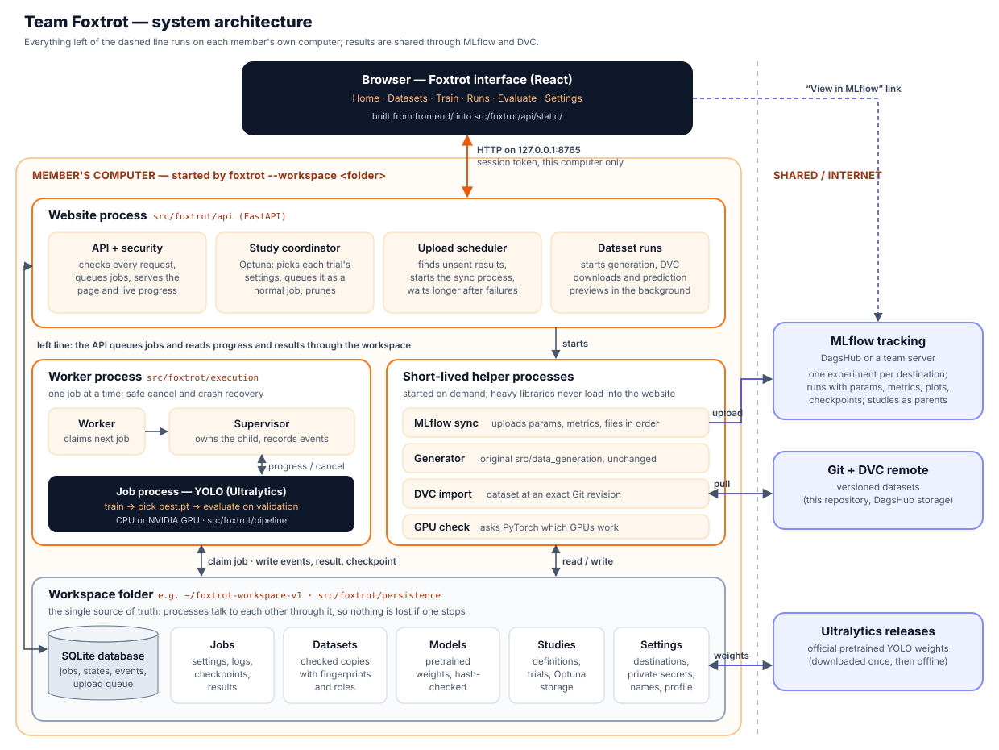

# Team Foxtrot: Local YOLO Training

A local website for Team Foxtrot's UAV shape detection: generate or import datasets,
train YOLO models on your own computer (CPU or NVIDIA GPU), run tuning studies,
evaluate on real labeled images, and find every run in MLflow (for example on DagsHub).
DVC keeps dataset versions; the original command-line pipeline still works unchanged.

## Architecture



- **Browser**: the interface talks only to Foxtrot on this computer (127.0.0.1, with a per-launch session token).
- **Website process**: checks requests and queues jobs; its background helpers run tuning studies, schedule MLflow uploads and start dataset work.
- **Worker process**: runs one job at a time in a supervised child process (YOLO training, then evaluation of the exact best checkpoint), on the CPU or an NVIDIA GPU.
- **Helper processes**: short-lived jobs (MLflow upload, the unchanged generator, DVC download, GPU check) so heavy libraries and credentials never load into the website.
- **Workspace folder**: the single source of truth (database, jobs, datasets, models, studies, settings); processes coordinate through it, so a crash or restart loses nothing.
- **Shared**: results go to MLflow (DagsHub or a team server); dataset versions come from Git + DVC; pretrained weights come once from Ultralytics.

## Start

```bash
.venv/bin/foxtrot --workspace ~/foxtrot-workspace-v1 --pipeline-adapter ultralytics
```

The browser opens at http://127.0.0.1:8765/. Stop with Ctrl+C. Setting up the
environment (Python 3.14, locked dependencies) is described in
[docs/development.md](docs/development.md).

| Page | What it is for |
| --- | --- |
| Home | Recent runs, workspace summary, what needs attention |
| Datasets | Generate a Foxtrot dataset, import a YOLO folder, or download a DVC version; name and preview them |
| Train | One training run (model, start weights, CPU/GPU, early stopping, all settings) or a tuning study |
| Runs | Progress, training output, results, MLflow links, resume and retry |
| Evaluate | Score a checkpoint on labeled real images, or preview predictions on unlabeled ones |
| Settings | Your name, MLflow destinations and experiment names, GPU check, setup check, storage |

## Documentation

| Topic | Document |
| --- | --- |
| Using the website, API overview | [docs/application.md](docs/application.md) |
| Training, models, settings, early stopping, GPU | [docs/training.md](docs/training.md) |
| Generating datasets | [docs/generation.md](docs/generation.md) |
| DVC versions and evaluation on real images | [docs/evaluation.md](docs/evaluation.md) |
| Tuning studies | [docs/studies.md](docs/studies.md) |
| Recovery and upload retries | [docs/recovery.md](docs/recovery.md) |
| Installation, coverage, limits, release record | [docs/release.md](docs/release.md) |
| Internals: storage, job states, worker, adapters | [docs/persistence.md](docs/persistence.md), [docs/lifecycle.md](docs/lifecycle.md), [docs/execution.md](docs/execution.md), [docs/adapters.md](docs/adapters.md) |
| Plan and current status | [docs/project/implementation_plan.md](docs/project/implementation_plan.md), [docs/project/implementation_status.md](docs/project/implementation_status.md) |
| Earlier research and roadmap (history) | [docs/history/](docs/history/) |

## Project layout

| Path | Purpose |
| --- | --- |
| `src/foxtrot/api/` | Website server: API endpoints, launcher (`foxtrot` command), security, GPU check, built interface in `static/` |
| `src/foxtrot/config/` | Checked settings and records: training settings, jobs, datasets, studies, results |
| `src/foxtrot/persistence/` | The workspace: database, jobs, datasets, models, names, recovery, cleanup |
| `src/foxtrot/execution/` | The worker that runs one job at a time in a supervised child process |
| `src/foxtrot/pipeline/` | Generation, splitting, YOLO training and evaluation |
| `src/foxtrot/studies/` | Tuning studies (Optuna) and dataset-recipe tuning |
| `src/foxtrot/tracking/` | MLflow upload plans, the uploader and its client |
| `frontend/` | Interface source (React + TypeScript); `npm run build` writes into `src/foxtrot/api/static/` |
| `tests/` | Automated checks (temporary workspaces; no real training or uploads) |
| `scripts/` | `verify_baseline.py` (all tests + protected-file check), `verify_frontend.mjs` |
| `docs/` | Documentation (above) |
| `src/data_generation/`, `src/train.py`, `src/split_dataset.py`, `src/test.py`, `src/class_names.py` | Original pipeline and generator (protected: the website runs the generator unchanged) |
| `params.yaml`, `dvc.yaml`, `dvc.lock`, `.dvc/`, `data/` | Original DVC pipeline, its settings and data (protected) |
| `pyproject.toml`, `requirements.txt`, `requirements-dev.in` | Package definition and locked dependencies |

## Checks

```bash
.venv/bin/python -B scripts/verify_baseline.py
```

Runs every test with temporary caches and confirms the protected files are unchanged.

## Original command-line pipeline

Use the verified Ubuntu/Python baseline described in the development guide.
Activate its environment, then install the locked dependencies if needed:

```bash
python -m pip install --require-hashes --no-build-isolation -r requirements.txt
```

Place backgrounds in `data/raw/` and edit `params.yaml`. The active script entry
point reads YAML; the retained legacy argument parser is not the current
configuration interface.

Run the stages from the repository root:

```bash
python src/data_generation/DataSetGeneration.py
python src/split_dataset.py
python src/train.py
python src/test.py
```

Alternatively, use `dvc repro` with the configured DVC environment and inputs.
DVC may reuse cached stage outputs. Source cleanup can invalidate a recorded stage
dependency; no pipeline or lockfile regeneration is performed by this cleanup.

Training currently uses YOLOv8n and the existing DagsHub tracking destination.
Configure your own tracking credentials locally using
`MLFLOW_TRACKING_USERNAME` and `MLFLOW_TRACKING_PASSWORD`, either in the
environment or the ignored `.env` file. See `src/train.py` for current behavior;
configurable tracking and broader model selection belong to the implementation plan.

Training recreates the ignored root `data.yaml`. Generation can recreate ignored
letter-resource caches. Neither needs to be committed.

Optional real-flight images belong in `data/test_real/images/`. The final script
skips if none are present. Its predictions are visual examples; quantitative
accuracy requires labeled evaluation data.

### Generation behavior

- `data_generation.n` means images per class.
- `data_generation.size` is a positive integer and produces exactly
  `size × size` detection images. Rectangular backgrounds are stretched to that
  square before objects and labels are drawn. This differs from training `imgsz`.
- PNG, JPG, and JPEG extensions are accepted case-insensitively. Backgrounds are
  validated and sorted before selection; corrupt images are skipped with a warning.
- Missing/unusable backgrounds and invalid output sizes fail before previous
  generated outputs are cleared.
- Incomplete letter-resource caches are rebuilt automatically. Generation fails
  explicitly if its retry budget cannot produce the requested count.
- Class IDs are `0 = Hexagon` and `1 = Triangle`, defined in
  `src/class_names.py`. Changing class order changes existing label meanings.

### Regression checks

With the project dependencies installed, run:

```bash
python -m unittest discover -s tests -v
```

The tests use temporary fixtures rather than regenerating the project's datasets
or starting training. Training-import checks require genuine YOLO dependencies.

The issue 3–7 corrections can change generated images and boxes. Existing datasets
and checkpoints are not rewritten automatically. Compare results using the same
code, inputs, configuration, and dependency versions. See
[docs/history/repository_verification.md](docs/history/repository_verification.md) for recorded evidence.
