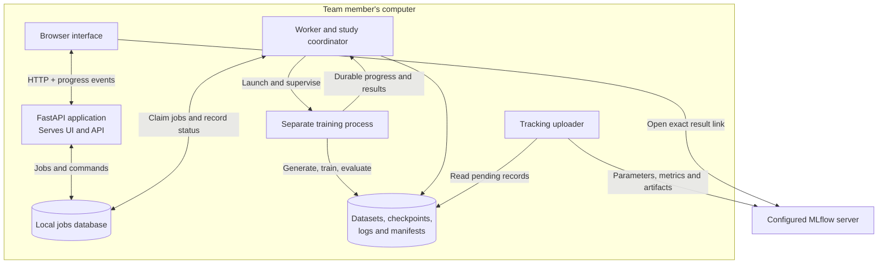

# Team Foxtrot: Local Training Website Implementation Plan

Date: **14 October 2026, Asia/Karachi**.

Architecture: **Option C — a local application serving both the website and API**.

Delivery approach: **Build a limited horizontal foundation first, then deliver complete vertical slices.**

Status: **Foundation implemented through H7 (fixture adapters only; see the progress list). H6 adapter boundaries are also implemented (fixture adapters only; see the progress list). H1–H5 are implemented, including a local worker, owned subprocess supervision, cancellation, and durable progress/recovery. H5 completion verification passed all 163 repository tests, including the 21 issue 3–7 regressions; 1,216 protected files were unchanged. The worker currently runs explicit infrastructure fixtures. No usable website, product API, or real training workflow has been delivered. H6–H7 and V1–V8 remain unimplemented. H6 awaits explicit user approval.**

This plan builds on [research.md](research.md), [project_roadmap.md](project_roadmap.md), and [repository_verification.md](repository_verification.md). Repository issues 3–7 are treated as resolved. Preserve their corrections and regression tests.

The original roadmap's Phase 5 (Jetson deployment) and Phase 6 (training CI/CD) remain outside scope. Local training replaces Colab as the main execution path.

## Implementation progress

Detailed baseline, verification evidence, working rules, and approval state are maintained in [IMPLEMENTATION_STATUS.md](IMPLEMENTATION_STATUS.md). Read both documents and applicable `AGENTS.md` instructions at the start of a new session, then recheck the repository using permitted read-only commands. The handoff does not grant permission to advance.

- [x] H1.1 — Record the starting repository baseline and create the handoff (15 October 2026).
- [x] H1 — Complete the development baseline (15 October 2026): pinned dependencies, installable skeleton, package boundaries, and verification commands. Editable and fresh wheel environments both passed all 21 regressions; 1,216 protected files were unchanged in each check. CPU runtime and temporary frontend build checks passed. Setup and scope: [docs/development.md](docs/development.md). User chose the current machine for now; a second machine and Docker containerization are deferred.
- [x] H2 — Complete the minimum configuration and result contracts (15 October 2026). H2.1–H2.8 cover training settings, job specifications, dataset metadata, immutable submitted/resolved snapshots, checkpoints, evaluation, job results, and progress events. The user reported individual/completion checks passed. All four retained `tests/test_config_contracts.py` checks were also freshly verified by the agent during H3 completion on 19 October 2026.
- [x] H3 — Complete isolated workspaces and basic persistence (19 October 2026). The user implemented and verified H3.1–H3.8; then authorized the agent to finish H3 and execute checks. SQLite migrations through version 3, configuration hashes, idempotent submission, one-active-job claims, exact artifact references, and owned temporary cleanup are implemented. Fresh-process fixtures preserve two jobs, configurations, checkpoint identities, and a claim; competing submissions/claims and interrupted transactions are checked. `.venv/bin/python -B scripts/verify_baseline.py`: 91/91 tests passed in 71.802s, including 66 workspace tests; 1,216 protected files unchanged. See [docs/persistence.md](docs/persistence.md).
- [x] H4 — Complete job states and durable progress (19 October 2026), under the user's express whole-H4 implementation/test authorization. Legal execution/tracking transitions, atomic SQLite events/errors, cursor replay, process birth identities, and conservative restart reconciliation are implemented. Real fixture process loss becomes interrupted; surviving children/ambiguous launches block new claims without automatic relaunch. Schema 4 preserves legacy records with an honest history snapshot. `.venv/bin/python -B scripts/verify_baseline.py`: **134/134 passed in 138.665s**, including 103 workspace checks, 6 lifecycle-rule checks, 4 H2 checks, and 21 regressions; 1,216 protected files unchanged. See [docs/lifecycle.md](docs/lifecycle.md).
- [x] H5 — Complete the process supervisor (21 October 2026), under explicit authorization to implement/test the whole milestone. The separate fixture worker claims jobs sequentially, records exact child ownership before START, drains stdout/stderr/progress, persists cancellation/exit metadata through schema 5, and performs bounded graceful/TERM/KILL cleanup of verified session members. Private host/workspace leases reject competing workers; shutdown preserves the queue. Real-process fixtures verify failures, cancellation, stubborn children in separate process groups, crash cleanup, restart without repetition, and bounded HTTP/ASGI responsiveness. `.venv/bin/python -B scripts/verify_baseline.py` (under a 300s test deadline): **163/163 passed in 151.271s**, including 29 new H5 checks; 1,216 protected files unchanged. See [docs/execution.md](docs/execution.md). Linux/pidfd and one OS user are the verified execution scope; real pipeline/tracking adapters remain H6/V1.
- [x] H6 — Pipeline and tracking adapter boundaries implemented (10 November 2026) under the user's explicit request to implement H6. Explicit-input generation/split/training/evaluation contracts, workspace dataset registry with content hashes, per-job `data.yaml`, code-owned fixture adapter run through the H5 supervisor, parent-side result verification, H2 `result.json`, schema 6 run associations and ordered tracking outbox, and a resumable uploader with an in-memory fixture client. 23 new H6 tests pass. Full suite later verified in the foundation exit check below (Python 3.14). See [docs/adapters.md](docs/adapters.md).
- [x] H7 — Local application shell implemented (11 November 2026) at the user's request to complete H7. One launcher command starts the loopback FastAPI app (health, capabilities, schemas, session, datasets, jobs, events, cancel, tracking destinations) and a separate worker, with coordinated Ctrl+C shutdown. Host/origin checks, a per-launch session token, security headers, write-only private credentials with log redaction. React/Vite shell (Setup, New training, Activity) built into the Python package, so no Node server is needed. 11 H7 tests pass, including a real launch that runs a fixture job to finished and stops cleanly; a headless Chrome screenshot confirmed rendering. See [docs/application.md](docs/application.md).
- [x] Foundation exit check — passed 11 November 2026 on Python 3.14.4: `verify_baseline.py` 197/197 in 41.6s, 1,216 protected files unchanged; YOLOv8n CPU forward pass and frontend toolchain check passed. V1 requires explicit approval.
- [ ] V1–V8 — Deliver and verify the vertical slices, in order.

## How to use this plan

Follow the delivery steps in sections 2 and 3. Section 4 describes the final system requirements and serves as a reference while implementing each step; it is not a list of components to complete before starting the website.

- **Horizontal foundation:** build the shared basics needed for the first working training workflow.
- **Vertical slice:** complete one user workflow across the browser, API, worker, pipeline, and tracking.
- **Completion check:** demonstrate the stated behavior before moving to the next step.

The overall sequence is:

```text
Shared basics
    → train an existing dataset from the browser
    → generate a dataset and train it
    → select models and broader parameters
    → retrieve versioned data and evaluate real labeled images
    → run a small tuning study
    → add adaptive and dataset-recipe tuning
    → complete recovery and synchronization workflows
    → verify full coverage and release to the team
```

The foundation prepares the first slice. Additional shared components are built when a later slice needs them. Completing the entire backend, every model adapter, or every parameter before connecting the browser is not a prerequisite.

## 1. Product goal and architecture

### 1.1 Member experience

Each team member installs Foxtrot on their computer. The application serves a local website and executes training on that same computer.

On first use, the member selects a workspace, checks their training environment, and configures MLflow. On subsequent uses, they launch Foxtrot and their browser opens a local address such as:

```text
http://127.0.0.1:8765
```

The member can then:

1. Generate a dataset or select an existing one.
2. Preview images, labels, classes, and split statistics.
3. Select a supported YOLO model.
4. Configure a single training run or a hyperparameter-tuning study.
5. Review the resolved configuration and resource budget.
6. Start training and watch progress.
7. Open the exact run or study in MLflow.

Every member runs their own application instance. Local job histories belong to their respective computers; shared results appear in the team's MLflow experiment.

Closing the browser should leave training running. Shutting down the computer interrupts training; recovery depends on saved checkpoints.

### 1.2 Local architecture

Separate the browser interface, job management, and training execution.



The local launcher starts the API and worker as separate processes. The worker owns training subprocesses; the API handles browser requests.

A slow training operation must not block the website, and a browser reload must not own the training lifecycle. FastAPI distinguishes small background tasks from heavy computation; a dedicated worker is appropriate here. Source: [FastAPI background-task guidance](https://fastapi.tiangolo.com/tutorial/background-tasks/).

#### Proposed technology stack

| Area | Proposed choice | Purpose |
| --- | --- | --- |
| Browser interface | React + TypeScript | Configuration forms, previews, progress, trial comparison |
| Frontend build | Vite | Package the interface as static assets |
| Local API | FastAPI | Serve the interface, validate requests, expose job operations |
| Configuration models | Pydantic | Typed validation and generated schemas |
| Local application storage | SQLite | Jobs, datasets, trials, events, tracking associations |
| Execution | Dedicated Python worker with subprocesses | Process isolation, cancellation, recovery |
| Training | Pinned Ultralytics + PyTorch environment | Reuse the current YOLO workflow |
| Tuning | Optuna | Sampling, study state, pruning |
| Experiment tracking | MLflow | Shared parameters, metrics, artifacts, comparisons |
| Dataset versioning | DVC | Retrieve and identify versioned input data |
| Progress transport | Server-Sent Events, with polling fallback | Stream progress to the browser |

Vite builds the frontend into static assets, and FastAPI serves those assets alongside the API. Members need the packaged application, not a separate Node development server. Sources: [Vite production builds](https://vite.dev/guide/build.html), [FastAPI static files](https://fastapi.tiangolo.com/tutorial/static-files/).

This design needs no public website hosting, cloud training service, or central job scheduler.

## 2. Part A — horizontal foundation

**Purpose:** establish the shared contracts and execution infrastructure that the first real training workflow needs.

Work through H1–H7, then apply the exit check. Keep the implementation small enough to connect to real training immediately afterward. A fixture job proves infrastructure behavior; it does not prove YOLO, MLflow, or browser integration.

**Working-agreement update (21 October 2026):** the user authorized H1, the remaining H3 work, all H4, and now all H5 implementation/testing as milestone-specific exceptions permitting agent edits and command execution. Each exception ends with that milestone. H5 is complete; H6 returns to explicitly approved steps, approximately 4–5 meaningful steps per H milestone. The agent may run permitted read-only inspection commands; the user normally copies supplied code and executes tests/builds/scripts. Agent edits require explicit authorization. Explain changes and commands in chat alongside the current step. Keep `IMPLEMENTATION_STATUS.md` factual and update it at whole-milestone completion, rather than after each small edit; mentoring explanations remain in chat. Passing checks and a handoff document never grant permission to advance.

### H1. Establish the development baseline

**Outcome:** a reproducible starting point and a clear package layout.

1. Record the current source revision, existing local changes, and the issue 3–7 remediation baseline.
2. Identify the operating systems and accelerators available to the team. Choose one initial development environment and one second machine for the first installation check.
3. Select and pin a compatible Python, PyTorch, Ultralytics, API, and frontend baseline. Add Optuna when the tuning slice requires it rather than building the tuning subsystem now.
4. Define package boundaries for configuration, local persistence, execution, pipeline adapters, tracking, and the browser interface.
5. Keep the existing CLI and DVC entry points usable while moving behavior behind reusable interfaces.
6. Establish focused local verification commands and preserve the generator regression suite. These are development checks, not the excluded cloud training CI/CD.

**Completion check:** another developer can create the baseline environment, import the application skeleton, and run the relevant existing regression checks without changing production datasets or training outputs.

**Boundary:** broader operating-system certification and polished installers are completed through the slices and release checks.

### H2. Define the minimum configuration and result contracts

**Outcome:** the application has one agreed format for a basic training request and its result.

1. Define a versioned job specification containing a dataset reference, registered model reference, a small set of training settings, device choice, and tracking destination reference.
2. Define immutable submitted and resolved configurations. Specify how defaults are resolved and how a new configuration creates a new job.
3. Define minimum dataset metadata: class mapping, train/validation references, content identity, and validation status.
4. Define the result contract: job ID, execution outcome, exact checkpoint path/hash, evaluation metrics, and tracking association.
5. Define a progress event format with job ID, sequence number, timestamp, event type, and payload.
6. Validate unknown keys, types, ranges, managed output paths, and schema versions. Keep secrets outside exported job specifications.

**Completion check:** a valid sample job is accepted; malformed or unsupported settings fail with useful field-level errors; the resolved configuration can be saved and read back.

**Boundary:** the first schema covers the first training workflow. Full parameter coverage and model-specific dependencies expand in V3 and are audited before release.

### H3. Build isolated workspaces and basic persistence

**Outcome:** each job has its own identity, configuration, state, and output folder.

1. Create the application workspace outside the source checkout, following the target layout in section 4.
2. Allocate job IDs and per-job folders. Save submitted and resolved manifests before execution.
3. Create the minimum SQLite records for jobs, execution state, tracking state, and event positions.
4. Establish database schema versioning and a migration mechanism so later slices can add trials and datasets without discarding history.
5. Make job claiming transactional and store a submission identity to prevent duplicate execution from repeated requests.
6. Keep application output writes inside the assigned workspace. Define safe cleanup rules for owned temporary files.
7. Store exact checkpoint and artifact references instead of searching shared output trees.

**Completion check:** two fixture jobs retain separate configurations and outputs; a repeated submission does not create another execution; restarting the application preserves their records.

**Boundary:** implement only the tables and storage behavior needed now. Optuna storage, dataset caches, and advanced retention arrive with their owning slices.

### H4. Define job states and durable progress

**Outcome:** the application can distinguish what is happening from what has been uploaded.

1. Implement the execution states described in section 4, including failure, cancellation, and interruption.
2. Keep execution status separate from tracking synchronization status.
3. Persist progress events and error details before presenting them to clients.
4. Support reading events after a sequence number so a reconnecting client can recover missed updates.
5. Define how stale running records are reconciled on restart using process ownership and liveness evidence.
6. Mark uncertain or stopped executions as interrupted; do not automatically launch another training process.

**Completion check:** a fixture emits ordered progress, its history survives restart, and loss of the fixture process produces an interrupted or failed record rather than a permanent running status.

**Boundary:** checkpoint continuation and full study recovery are later user workflows. Correct state recording starts here.

### H5. Build the process supervisor

**Outcome:** work runs outside API requests and can be stopped safely.

1. Create one local worker that claims queued jobs.
2. Launch each execution in a separate owned subprocess, initially allowing one training execution at a time per machine.
3. Pass structured job data and explicit paths to the process; do not accept arbitrary shell commands from job specifications.
4. Capture output, progress, exit status, and process ownership.
5. Implement graceful cancellation followed by bounded termination of the owned process group and child processes.
6. Define launcher shutdown behavior so the browser can close independently of the worker.
7. Detect an existing application/worker instance or otherwise prevent competing workers from claiming the same job.

**Completion check:** a controlled fixture starts, reports progress, fails clearly when instructed, and cancels without leaving owned children running. It does not block API responsiveness.

**Boundary:** this step builds the supervisor, not the complete YOLO or tuning implementation.

### H6. Establish pipeline and tracking adapter boundaries

**Outcome:** real integrations can connect to stable inputs and outputs.

1. Define the generation, splitting, training, and evaluation interfaces described in section 4.
2. Prepare the training/evaluation path to receive explicit dataset and output paths rather than rewriting root configuration.
3. Keep shared class metadata lightweight and preserve the existing issue 7 correction.
4. Define tracking operations for run creation, parameter logging, metric logging, artifact upload, result links, and final status.
5. Define where the local-to-MLflow run association and pending upload records will be persisted.
6. Use small fixtures to prove the supervisor can call an adapter and record its result.

**Completion check:** a fixture adapter receives the intended configuration and returns an identifiable result in its assigned workspace.

**Boundary:** real YOLO training and real MLflow integration are completed together with the browser in V1. Generator refactoring is completed in V2. No speculative adapter for every future model is needed now.

### H7. Assemble the local application shell

**Outcome:** the local application starts consistently and is ready for the first functional screen.

1. Create the FastAPI application and mount the bundled frontend.
2. Add health, basic capabilities, and schema endpoints.
3. Build a minimal browser shell with places for setup, a training form, and job progress.
4. Connect the launcher to the API and worker and provide a documented development startup command.
5. Bind to loopback, validate hosts/origins, and establish a local session for state-changing requests.
6. Keep credentials in backend-managed local configuration and redact them from logs and exported settings.
7. Confirm the frontend can retrieve capabilities and display a fixture job's state.

**Completion check:** one launch starts the local application, the browser loads, and a fixture's persisted state can be displayed without a separate production Node server.

**Boundary:** full screen design and all API endpoints are built as their workflows are delivered.

### Foundation exit check — switch to vertical delivery

Proceed to V1 when all of the following are demonstrated:

- A basic job can be validated and assigned an isolated workspace.
- Its configuration and state survive an application restart.
- The worker can run an owned subprocess, record events and results, and cancel it safely.
- Duplicate submission does not create duplicate execution.
- The local browser shell can communicate with the API.
- Relevant existing regression checks still pass.

**Stop expanding the foundation at this point.** It is not necessary to complete all models, dataset modes, parameters, studies, or recovery features before V1.

## 3. Part B — vertical slices

Each slice delivers a usable workflow. Implement the necessary UI, API, worker behavior, pipeline changes, tracking, and verification together. Keep previous workflows working as the application grows.

### V1. Train an existing dataset and open its MLflow result

**User outcome:** a member selects an existing detection dataset, starts one YOLOv8n run, follows progress, and opens that exact result.

**Depends on:** the foundation exit check.

1. Build the minimum setup screen for workspace, device, and tracking destination. Verify access before starting a remotely tracked job.
2. Add a browser flow to register an existing local YOLO detection dataset, read its own class mapping, and validate its images, labels, and train/validation splits.
3. Add a basic training form using YOLOv8n and a small set of settings such as epochs, batch size, image size, seed, and device.
4. Connect form submission to validated job creation, immutable manifests, and the worker queue.
5. Implement the real training adapter with explicit dataset/output paths and a fresh subprocess.
6. Capture epoch metrics and progress through callbacks. Evaluate the exact selected checkpoint and record its hash.
7. Implement explicit MLflow run creation and logging for the single-run contract. Disable overlapping automatic MLflow logging.
8. Persist metrics and upload work locally; show upload failures separately from training failures. Provide an explicit retry path using the same recorded run association. More complete automatic recovery is delivered in V7.
9. Add the activity screen, cancellation, browser reconnection, and a result view with the exact MLflow link. Redirect only after required uploads finish.
10. Build a basic installable package and repeat the workflow on a second member's machine.

**Completion checks:**

- A small real training run completes from the browser and its resolved settings, metrics, best checkpoint, evaluation, and dataset identity appear in the intended MLflow run.
- Repeated clicks do not duplicate training; closing/reopening the browser preserves progress.
- Cancellation stops the owned execution; a failed process is visible and does not leave the UI stuck.
- A tracking failure preserves local results and is not reported as fully synchronized.
- A second member can install and perform the same workflow.

**Scope limit:** use an existing dataset and one baseline model. Full generation, parameter coverage, and tuning are not required to finish this slice.

### V2. Generate a Foxtrot dataset, preview it, and train

**User outcome:** a member chooses generation settings, sees labeled samples, and trains on the resulting dataset.

**Depends on:** V1.

1. Refactor the generator and split functions to accept explicit configuration, seeds, resources, and output directories.
2. Move writable glyph resources and caches into the workspace; preserve all corrections for issues 3–7.
3. Add generator controls for the currently supported YAML settings. Label image count as images per class and distinguish generated canvas size from training image size.
4. Generate previews through the same configuration path used for full generation, with their own outputs and recorded seed.
5. Validate generated labels and counts before publishing the dataset. Build in temporary storage and publish only completed datasets.
6. Record recipe, input hashes, source-background identity, class mapping, seeds, and output hashes in a dataset manifest.
7. Add split controls, including a reproducible group-aware path so related source backgrounds can remain in one partition.
8. Cache datasets by recipe and input identity; protect cache creation from interruption or conflicting writes.
9. Connect the prepared dataset to the V1 training flow and log generation/split provenance in MLflow.
10. Demonstrate that a new generation request cannot overwrite another dataset or the repository's existing outputs.

**Completion checks:**

- The member completes generate → preview → split → train → MLflow entirely through the interface.
- Counts, output dimensions, class mapping, and displayed labels agree with the actual files.
- Invalid inputs fail before replacing valid outputs.
- Unchanged dataset identity can reuse a validated cache; changed recipe/input identity creates a distinct dataset.
- The issue 3–7 regression checks remain valid.

### V3. Select models and expand parameter coverage

**User outcome:** a member selects a supported model and configures applicable training and dataset settings through validated forms.

**Depends on:** V2.

1. Implement the model registry starting with the tested detection families/variants supported by the pinned runtime.
2. Support registered pretrained weights, compatible local checkpoints, and registered architectures initialized from scratch.
3. Expand the backend schema by parameter group. Add frontend controls, actual execution forwarding, and resolved-value logging together for each group.
4. Integrate remaining applicable legacy generator options with explicit semantics and meaningful checks before exposing them.
5. Add the advanced structured editor using the same validation as the guided forms.
6. Enforce model/task applicability and dependent settings, including optimizer/learning-rate interactions.
7. Keep dataset paths and output identities application-managed; show their resolved values without allowing cross-job writes.
8. Handle imported datasets using their own validated class mapping.
9. Add a coverage report classifying each relevant runtime key and supported generator setting.
10. Demonstrate representative runs across the supported model registry and parameter groups.

**Completion checks:**

- Changing an exposed setting changes the resolved execution configuration and is logged.
- Unsupported or incompatible combinations fail before training.
- Model and checkpoint identities are traceable to the reported results.
- Every supported parameter has a form or advanced-editor path; unresolved coverage gaps are recorded explicitly.
- Existing V1 and V2 workflows still function.

**Scope note:** broad runtime/task compatibility is not implied by the YOLO name. Other runtimes or tasks need their own adapters and data contracts.

### V4. Retrieve versioned datasets and evaluate labeled real images

**User outcome:** a member can train using a recorded DVC dataset version and assess a chosen checkpoint on labeled evaluation data.

**Depends on:** V3.

1. Add the DVC dataset-registration flow with repository/revision and data references resolved locally.
2. Retrieve inputs into a controlled workspace without changing the source checkout or overwriting other datasets.
3. Validate and record the exact revision, content identity, class mapping, and split policy.
4. Add registration of labeled real-flight validation and held-out test datasets, including grouping by flight/scene where available.
5. Add an evaluation workflow that selects an exact checkpoint and compatible labeled dataset, then records metrics and artifacts with both identities.
6. Keep unlabeled prediction previews distinct from quantitative evaluation.
7. Establish fixed evaluation configurations that studies will reference; reserve final test data from search objectives.
8. Retain the existing CLI/DVC pipeline as a caller of the reusable components. Browser training creates a new execution while prepared data may be reused.

**Completion checks:**

- A browser job uses the requested DVC revision and records its data identity in MLflow.
- Evaluation scores and plots refer to the exact selected checkpoint and dataset.
- Unlabeled images produce previews without being presented as measured accuracy.
- Validation and final test roles are distinguishable, and final test data is not offered as a tuning objective.

### V5. Run a small sequential tuning study

**User outcome:** a member defines a small grid or random search, runs several trials, and compares their MLflow results.

**Depends on:** V3 and the fixed evaluation contract established in V4.

1. Add a study form for one selected model, fixed dataset/splits, objective, parameter choices/ranges, trial budget, and time limits.
2. Validate search-space types and dependencies using the same parameter metadata as ordinary jobs.
3. Add persistent study/trial identities and Optuna storage with one coordinator writing it.
4. Use ask-and-tell to resolve each trial into an ordinary immutable training job.
5. Run trials sequentially through the existing training pipeline. Reuse the same validated dataset and evaluation settings.
6. Create one MLflow study parent and an explicitly associated child run for each trial.
7. Add trial progress, results, failure reasons, and best-trial/checkpoint links to the interface.
8. Implement stop-study behavior that stops launching new trials and clearly defines whether the active trial finishes or is cancelled.
9. Persist completed trial outcomes and reconcile interrupted trials so continuing a study cannot silently repeat completed work.
10. Verify a small grid and a seeded random study before adding adaptive sampling.

**Completion checks:**

- A finite grid executes the expected configurations, within the stated budget.
- Each trial has its own configuration, workspace, score, checkpoint identity, and MLflow run.
- The best-trial result matches the selected objective and actual evaluated checkpoint.
- Failures and out-of-memory events remain visible; configuration is not silently changed.
- Study continuation preserves completed trials.

### V6. Add adaptive search, model comparison, and dataset-recipe tuning

**User outcome:** a member can automate a broader search while keeping comparisons fair and resource use bounded.

**Depends on:** V5 and the generation/evaluation contracts from V2 and V4.

1. Add TPE sampling, logarithmic ranges, and conditional search spaces through the existing study form and coordinator.
2. Offer equal trial budgets per selected model and a separately labeled combined model search.
3. Display total planned trials for equal budgets and finite grids, and maximum trial/time limits for adaptive searches.
4. Add dataset-recipe parameters to search spaces. Sample dependent bounds using a valid constrained representation.
5. Freeze validation data before the study begins; regenerate only training data when the recipe changes.
6. Exclude evaluation source groups from generated training inputs and keep classes and evaluation settings fixed.
7. Cache repeated training recipes using complete input/recipe identities.
8. Add pruning after intermediate metrics and final outcomes are reliable. Begin with pruning within the same model or leave it disabled for cross-model comparisons.
9. Add a workflow to repeat promising configurations under several seeds and record each repeat.
10. Summarize best overall and per-model trials, failures, resource use, and the search definition in the UI and MLflow.

**Completion checks:**

- Adaptive trials use the sampled values and respect the budget.
- Equal-budget model comparisons receive the advertised number of trial attempts.
- Dataset-recipe changes never redefine the evaluation set.
- Pruned, failed, cancelled, and completed trials remain distinguishable in Foxtrot, with appropriate mapped tracking statuses and reason tags.
- Repeated-seed comparisons preserve individual run results.

### V7. Resume interrupted work and recover tracking uploads

**User outcome:** a member can reopen Foxtrot after a failure, understand what happened, and continue eligible work without losing or duplicating results.

**Depends on:** V1–V6. Basic cancellation, durable results, truthful upload state, and study continuation already belong to the earlier slices.

1. Add a recovery screen showing interrupted jobs, available checkpoints, pending uploads, and studies with unfinished trials.
2. Implement an explicit resume-training action that validates checkpoint/runtime compatibility and allowed configuration changes.
3. Distinguish continuing a checkpoint, retrying a failed attempt, creating a new experiment, and continuing a study.
4. Complete automatic upload retries with backoff, restart persistence, artifact verification, and reconciliation of ambiguous requests.
5. Ensure pending uploads retain the exact run association; do not create fresh runs simply because a response was lost.
6. Support user-triggered retry and visible synchronization errors for credentials, connectivity, or quota failures.
7. Reconcile worker/process failures and Optuna trial state together, including a crash between completing training and recording its study outcome.
8. Verify cancellation and recovery at preparation, training, evaluation, and synchronization boundaries.
9. Restore result links and optional redirect behavior only when required artifacts are synchronized.

**Completion checks:**

- A supported checkpoint can resume with clear provenance and no silent setting changes.
- Restarting during a study does not repeat completed trials or leave unowned training processes.
- A tracking outage followed by reconnection preserves metrics, steps, artifacts, and intended run associations.
- Ambiguous requests are reconciled or surfaced for recovery rather than assumed successful.
- The UI never confuses training completion with upload completion.

### V8. Complete coverage, packaging, and team release

**User outcome:** team members can install the application and use the complete supported workflow reliably.

**Depends on:** V1–V7.

1. Audit all requirements in section 4 against delivered workflows. Close remaining parameter, artifact, dataset-mode, and tracking-destination gaps.
2. Resolve every parameter-coverage item for the selected runtime/task contract; do not declare full coverage while required applicable settings remain unimplemented.
3. Finish settings, history, artifact retention, and safe cleanup flows. Prevent cleanup of active jobs or unsynchronized required artifacts.
4. Test configured DagsHub, local MLflow, and team-hosted MLflow destinations as applicable, including access and deep links.
5. Confirm the chosen shared destination fits the team's privacy, collaboration, and storage needs without a required paid subscription.
6. Finalize the packaged frontend, launcher, setup checks, credential configuration, and supported environment documentation.
7. Add and verify metadata migrations and upgrades while preserving workspaces. Do not replace a runtime used by active jobs.
8. Repeat installation and complete workflows on each supported OS/device combination; document limitations rather than claiming untested support.
9. Run a two-member pilot covering generation, single runs, studies, shared tracking, cancellation, and recovery.
10. Record the release's supported models, parameter coverage, known limitations, and acceptance evidence.

**Completion checks:**

- Members can install without frontend build tools and launch the local UI.
- Two independent installations train locally and attribute results correctly in shared MLflow.
- All supported workflows satisfy their acceptance checks and the system contracts below.
- No unresolved required feature is hidden behind a claim that the prototype is complete.

### Delivery overview

| Stage | First usable outcome | Work added across layers |
| --- | --- | --- |
| H1–H7 | Shared infrastructure proven with a fixture | Configuration, persistence, isolation, process ownership, application shell |
| V1 | Train an existing dataset and view MLflow results | Basic UI/API, real training/evaluation, progress, explicit tracking, initial package |
| V2 | Generate and train from the UI | Generator controls, previews, splitting, caching, dataset provenance |
| V3 | Select models and broader parameters | Registry, schema-driven controls, compatibility rules, parameter forwarding |
| V4 | Use versioned data and evaluate real labeled data | DVC retrieval, dataset roles, checkpoint-specific evaluation |
| V5 | Run a small study | Study UI, sequential coordinator, trial tracking, continuation |
| V6 | Run advanced studies | Adaptive search, model budgets, recipe tuning, pruning, repeats |
| V7 | Recover interrupted work and uploads | Recovery UI, checkpoint continuation, upload reconciliation |
| V8 | Release the complete supported application | Coverage audit, environment verification, upgrades, team pilot |

## 4. Final system contracts and architecture reference

These requirements describe the target application. Implement each requirement with its owning slice above. The architecture remains Option C throughout.

### 4.1. Free operation and tracking destinations

Keep the existing DagsHub integration as the initial shared-tracking candidate, but remove its hardcoded URL from training code.

Support three destinations:

| Destination | Appropriate use | Limitation |
| --- | --- | --- |
| Existing DagsHub repository | Convenient shared team tracking | Free-plan privacy, collaboration, and storage limits |
| Local MLflow | Completely local operation | Other members do not automatically see results |
| MLflow on an existing team computer/server | Shared tracking using existing hardware | Team manages availability, storage, and access |

At the time of planning, DagsHub advertises unlimited public-repository collaborators and public experiment tracking, but limits its free private projects to two collaborators and up to 100 tracked experiments. Do not assume the private free plan covers the whole team, and do not change repository visibility automatically. Recheck provider limits before rollout. Source: [DagsHub pricing](https://dagshub.com/pricing/).

MLflow supports local storage and database-backed tracking, allowing the application to retain the same logging interface across these destinations. Source: [MLflow tracking](https://mlflow.org/docs/latest/ml/tracking/).

The guaranteed design goal is **no required software subscription or paid cloud training**. Shared hosting availability and storage capacity depend on the selected destination. Existing hardware, electricity, and maintenance remain real costs.

### 4.2. Reusable pipeline components

The current scripts still read shared configuration and write shared output paths. The website should call a pipeline that receives explicit inputs and returns explicit results.

Proposed conceptual interfaces:

```python
generate_dataset(config, inputs, output_dir) -> DatasetManifest
split_dataset(dataset, split_config, output_dir) -> SplitManifest
train_model(model_config, training_config, dataset, output_dir) -> TrainingResult
evaluate_model(checkpoint, evaluation_config, dataset) -> EvaluationResult
```

These are design interfaces, not existing implemented functions.

| Existing component | Planned change |
| --- | --- |
| `src/data_generation/DataSetGeneration.py` | Accept configuration, seed, resource paths, and output directory explicitly |
| `src/split_dataset.py` | Accept an input dataset, split policy, seed, and output directory |
| `src/train.py` | Accept selected model, complete supported training settings, dataset YAML, and run directory |
| `src/test.py` | Require the exact checkpoint path; separate visual predictions from labeled evaluation |
| `src/class_names.py` | Remain the default Foxtrot class definition; record the actual mapping with each dataset |
| `params.yaml` | Remain a default/example configuration and compatibility input |
| `dvc.yaml` | Continue supporting the CLI workflow through the refactored components |

Preserve the corrections for issues 3–7 and their regression tests.

Two details from the current code must be reflected accurately in the interface:

- `n` means **images per class**. With Hexagon and Triangle, `n: 100` produces 200 images.
- `size` now controls a **square generated canvas**, and rectangular backgrounds are stretched to it. YOLO's training `imgsz` remains a separate setting.

Generated letter resources and other writable caches must move into the application workspace. Isolating training outputs is insufficient if the generator still rewrites resources inside the source tree.

### 4.3. Workspaces and immutable configuration

Use an application data directory outside the source checkout:

```text
foxtrot-workspace/
├── app.sqlite
├── optuna.sqlite
├── settings/
├── models/
├── datasets/
│   └── <dataset-id>/
│       ├── manifest.json
│       ├── data.yaml
│       └── ...
├── jobs/
│   └── <job-id>/
│       ├── submitted.json
│       ├── resolved.json
│       ├── provenance.json
│       ├── events.jsonl          # optional export; canonical history in app.sqlite
│       ├── logs/
│       ├── trials/
│       │   └── <trial-id>/
│       │       ├── config.json
│       │       ├── metrics.jsonl
│       │       ├── weights/
│       │       └── evaluation/
│       └── summary.json
└── tracking-outbox/
```

Record:

- The configuration submitted by the user.
- The complete resolved configuration, including defaults.
- Dataset and checkpoint hashes.
- Runtime versions and source revision.
- Local job/trial IDs and their MLflow run IDs.

Once submitted, a job's configuration is immutable. **Edit and rerun** creates a new job linked to the previous one.

Shared datasets become read-only after successful validation. Build them in temporary directories and publish them atomically only when complete. Cache entries need locks and completion markers so interrupted generation cannot leave something that looks reusable.

### 4.4. Parameter coverage and schema

The coverage contract is:

> Every applicable parameter supported by the selected, tested model/runtime/task, plus every supported Foxtrot dataset-generation setting.

The frontend must not maintain an unrelated list of fields. The backend exposes the authoritative schema, including:

```text
name
type and default
allowed values or bounds
description and unit
applicable model/task/runtime
dependencies and incompatibilities
user-editable or application-managed
tunable or fixed
supported search-space types
```

Pydantic can generate JSON Schema for typed configuration models. Foxtrot-specific metadata supplies descriptions, dependencies, and tuning rules. Source: [Pydantic JSON Schema](https://docs.pydantic.dev/latest/concepts/json_schema/).

#### Parameter groups

| Group | Coverage |
| --- | --- |
| Dataset generation | Counts, canvas size, shapes, scale, noise, blur, colors, letters, lighting, borders |
| Dataset preparation | Input references, class mapping, split policy, seeds, validation |
| Model | Family, variant, checkpoint, initialization |
| Training | Epochs, batch, image size, optimizer, learning rates, losses, augmentation |
| Runtime | Device, workers, caching, precision, deterministic settings |
| Evaluation | Evaluation dataset and supported validation settings |
| Study | Search spaces, sampler, objective, trial/time limits, pruning |
| Tracking | Destination, experiment, artifact policy |

Provide a guided form and an advanced structured editor. Both go through the same backend validation.

Some fields are visible but application-managed: dataset YAML location, output directory, run name, and run identity. They must not allow one job to overwrite another job's files.

Validate interactions as well as individual fields. For example, current Ultralytics documentation says `optimizer="auto"` ignores a supplied `lr0`. A study tuning learning rate must select an optimizer that actually uses it. Verify this behavior against the pinned runtime. Source: [Ultralytics configuration](https://docs.ultralytics.com/usage/cfg/).

Add a parameter-coverage check during development: every relevant runtime key must be classified as exposed, managed, inapplicable, or explicitly unsupported with a reason. Adding a field to a form is not evidence that it reaches training.

Legacy generator options require integration and validation before being advertised as supported. Keep generator ranges distinct from study search ranges.

### 4.5. Model registry

Start with the existing YOLOv8 detection path, then add additional detection families supported by the pinned runtime.

Each registry entry declares:

```text
model ID and display name
runtime adapter
task
available variants
checkpoint source
supported configuration schema
compatibility constraints
```

The interface can offer:

- A supported pretrained checkpoint.
- A registered architecture initialized from scratch.
- A compatible local checkpoint.

Record the checkpoint hash and initialization mode for every run.

Do not promise every model called YOLO through one implementation. Families requiring another repository or training API need a separate adapter.

Detection remains the initial task because the current dataset produces bounding boxes. Letter-only modes, segmentation, pose, or other tasks become selectable only after their data and training contracts are implemented.

For imported datasets, use their validated class mapping rather than forcing Hexagon and Triangle.

### 4.6. Dataset preparation

Support three input modes:

1. Generate with Foxtrot.
2. Select an existing local YOLO detection dataset.
3. Retrieve a dataset from a recorded DVC revision.

Members register local folders through the application. The backend resolves those folders; large datasets do not need to travel through a browser upload.

Before training, validate:

- Images are readable.
- Labels satisfy the selected task's format.
- Class IDs match the dataset mapping.
- Bounding boxes have valid coordinates and dimensions.
- Required splits are nonempty.
- Missing labels are handled according to an explicit policy.
- Split overlap and duplicate images are reported.

The preview shows labeled examples, class counts, dimensions, split sizes, and warnings.

Record source-background identity for generated images. This enables grouped splitting so images derived from the same background can remain in one partition. Real-flight data should similarly support grouping by flight or scene.

Cache generated datasets using the recipe, generation seed, input hashes, class mapping, and generator/runtime version. Reuse the dataset only when that identity matches.

### 4.7. Fair evaluation and checkpoint identity

For training-parameter tuning, generate or select one dataset and reuse the same splits for every trial.

For dataset-recipe tuning:

- Freeze validation data before the study starts.
- Regenerate only the training data when a sampled recipe changes.
- Exclude validation source groups from training generation.
- Keep the class mapping and evaluation settings fixed.

Otherwise, tuning can reward a recipe for producing easier validation images.

Use **mAP50–95 on the fixed validation set** as the initial objective. Track precision, recall, per-class metrics, and small-target performance where the evaluation implementation supports it.

Treat unlabeled real-flight images as visual inference examples. They cannot establish real-world accuracy.

After selecting promising configurations, repeat them under several training seeds. Use a separately held-out test set for final assessment.

The objective must identify the checkpoint being scored. Re-evaluate the selected saved checkpoint with the fixed evaluation settings, and link that score to its exact hash. If Foxtrot offers custom objectives, checkpoint selection must follow that objective rather than silently using a trainer's different internal selection rule.

### 4.8. Job lifecycle

Execution states:

```text
draft → validating → queued → preparing → training → evaluating → finished
                          ↘ failed / cancelled / interrupted
```

Track upload status separately:

```text
pending → syncing → synced
                 ↘ retrying / failed
```

#### Execution sequence

1. Validate the schema and configuration dependencies.
2. Check hardware, disk space, input data, checkpoint availability, and tracking access.
3. Persist the immutable job manifest.
4. Claim the job transactionally.
5. Prepare or reuse the dataset.
6. Assign the tracking identity.
7. Launch training in a fresh subprocess.
8. Persist epoch metrics, logs, progress, and checkpoints.
9. Evaluate the exact selected checkpoint.
10. Upload required results and verify completion.
11. Show the result and navigate to MLflow when appropriate.

Initially, run **one training process at a time per machine**. This gives predictable behavior for GPU memory, CPU loading, and dataset generation. Add concurrency only after measurement.

The worker owns a process group so cancellation also stops data-loader children. Cancellation first requests a graceful stop, then terminates after a bounded timeout.

On restart, reconcile saved job state with actual processes and checkpoints. A stale running record becomes interrupted; it must not trigger an unexamined duplicate launch.

### 4.9. Hyperparameter tuning

A study is a collection of trials. Each trial resolves to a complete ordinary training configuration and runs through the same dataset, training, evaluation, and tracking components.

#### Search-space types

| Type | Example |
| --- | --- |
| Integer range | Epochs from 30 to 90 with step 15 |
| Float range | Momentum from 0.85 to 0.95 |
| Logarithmic range | Learning rate from `0.00001` to `0.01` |
| Categorical choices | Batch sizes 8, 16, 32 |
| Model choices | Several registered YOLO variants |
| Dataset choices | Noise levels, lighting probability, shape-scale recipes |

Optuna supports numerical, categorical, logarithmic, and conditional search spaces. Source: [Optuna search spaces](https://optuna.readthedocs.io/en/stable/tutorial/10_key_features/002_configurations.html).

Keep two concepts visibly separate:

- A generator range samples variation **within one dataset**.
- A tuning range samples configuration choices **between training trials**.

For dependent bounds, sample a valid pair or use a constrained representation. Do not independently sample lower and upper values that frequently produce invalid recipes.

#### Study modes

| Mode | Behavior |
| --- | --- |
| Grid | Exhaustively evaluate a finite set of combinations |
| Random | Sample configurations up to the selected budget |
| Adaptive | Use Optuna's TPE sampler to choose subsequent configurations from previous outcomes |

Use TPE as the default adaptive strategy. Add pruning after full-length trials work reliably. Optuna provides separate sampling and pruning mechanisms. Source: [Optuna optimization algorithms](https://optuna.readthedocs.io/en/stable/tutorial/10_key_features/003_efficient_optimization_algorithms.html).

#### Model-comparison budgets

Offer two choices:

- **Equal budget per model:** each selected model receives the same number of trials.
- **Combined search:** model identity is sampled alongside other parameters.

Recommend equal budgets when the user wants a meaningful comparison. For example:

```text
3 models × 10 trials per model = 30 training trials
```

Show this count before starting. A global 10-trial study across three models is a different experiment and must be labeled accordingly.

Keep epoch ceilings, data, and evaluation settings comparable. If pruning is enabled across different architectures, account for different learning speeds. Initially, prune within each model's study or leave pruning disabled.

Every study needs:

- Maximum trials and wall-clock budget.
- Per-trial training limits.
- Search seed.
- Objective name and direction.
- Failure policy.
- Artifact retention policy.

Out-of-memory trials are recorded as failed with their attempted configuration. Silently reducing batch size would change the experiment.

#### Coordinator and persistence

Use Optuna's ask-and-tell interface:

1. Request the next trial.
2. Resolve and validate its configuration.
3. Persist the trial-to-job association.
4. Launch a fresh training process.
5. Receive progress and final evaluation.
6. Record complete, pruned, or failed status.
7. Continue until the budget is exhausted.

This keeps process control in Foxtrot while Optuna handles optimization. Source: [Optuna ask-and-tell interface](https://optuna.readthedocs.io/en/stable/tutorial/20_recipes/009_ask_and_tell.html).

For the initial sequential design, keep Optuna storage local with one coordinator writing it. Do not share that SQLite file between teammates or parallel workers. Optuna warns against SQLite for parallel optimization. Its automatic heartbeat behavior does not cover ask-and-tell in the same way, so Foxtrot must reconcile interrupted trials itself. Source: [Optuna storage and recovery guidance](https://optuna.readthedocs.io/en/stable/faq.html).

**Resume study** preserves completed trials and continues the remaining budget. **Resume interrupted training** is a separate operation governed by checkpoint compatibility.

### 4.10. MLflow logging contract

Foxtrot explicitly owns logging. Replace `mlflow.last_active_run()` as the ownership mechanism. Store explicit run IDs and pass them through the job lifecycle.

Use a Foxtrot tracking adapter with Ultralytics callbacks to capture training events. Disable overlapping automatic MLflow logging in that worker environment so two integrations do not create competing runs. Ultralytics provides training and validation lifecycle callbacks. Source: [Ultralytics callbacks](https://docs.ultralytics.com/usage/callbacks/).

Suggested hierarchy:

```text
Experiment: Foxtrot Detection
├── Single training run
└── Tuning study parent
    ├── Trial 001
    ├── Trial 002
    └── Trial 003
```

Each trial logs:

| Category | Required content |
| --- | --- |
| Identity | Job, study, trial, author, status, timestamps |
| Configuration | Submitted settings, resolved settings, sampled parameters |
| Provenance | Source revision, runtime versions, model/checkpoint hash |
| Dataset | Manifest, content identity, class mapping, split policy, seeds |
| Epoch data | Available losses, validation metrics, learning rates, timing |
| Final evaluation | Selected-checkpoint metrics, per-class results, plots |
| Artifacts | Best checkpoint, results CSV, manifests, previews, sanitized logs |
| Failures | Reason, last available metrics, checkpoint availability |

The study parent records the search definition, budget, completed/failed/pruned counts, and links to the best trial and per-model winners.

Log every trial's results. Large artifacts need a declared policy: default to each completed trial's best checkpoint and essential plots; make additional checkpoints and full generated datasets configurable. If storage is insufficient, report an incomplete upload rather than silently dropping required artifacts.

MLflow's client API supports explicit run operations, parameter/metric logging, and artifact logging. Source: [MLflow client API](https://mlflow.org/docs/latest/api_reference/python_api/mlflow.client.html).

### 4.11. Tracking outages and redirects

Persist metrics and artifact manifests locally before uploading. Use a durable upload queue recording run associations, event identities, metric steps, and acknowledged uploads.

Default behavior:

- Validate remote tracking access before starting.
- If connectivity fails during training, continue locally.
- Retry uploads with backoff.
- Show **Training finished — upload pending**.
- Resume synchronization after application restart.

Retries must reconcile ambiguous requests, especially run creation and metric uploads. Do not assume the tracking service guarantees exactly-once delivery.

Keep the tracking API URI separate from the browser-facing MLflow URL.

For automatic navigation:

- Single job: open its exact run after required uploads complete.
- Study: open the study parent, with a separate best-trial link.
- Closed tab: restore status when the application is reopened.
- Incomplete upload: retain the local result page and show the pending state.

A same-tab redirect after completion avoids relying on browser popup permission. Keep a persistent **View in MLflow** button as well.

### 4.12. Website screens and API boundaries

#### Main screens

| Screen | Main responsibilities |
| --- | --- |
| Setup | Workspace, environment checks, hardware, tracking connection |
| Datasets | Register/generate data, inspect labels, manage splits and manifests |
| New training | Select model, configure parameters, review resolved settings |
| New study | Select models, search spaces, objective, budgets, pruning |
| Activity | Queue, epoch progress, logs, trials, cancellation, recovery |
| History | Filter jobs, inspect artifacts, rerun configurations, open MLflow |

#### Proposed API boundaries

```text
GET  /api/capabilities
GET  /api/schemas
GET  /api/models

POST /api/datasets
POST /api/datasets/{id}/validate
GET  /api/datasets/{id}/preview

POST /api/jobs
GET  /api/jobs/{id}
GET  /api/jobs/{id}/events
POST /api/jobs/{id}/cancel

POST /api/studies
GET  /api/studies/{id}
POST /api/studies/{id}/stop
POST /api/studies/{id}/resume

POST /api/tracking/check
POST /api/jobs/{id}/retry-sync
```

Job submission needs an idempotency key so a double-click or request retry does not launch duplicate training. Progress events need sequence IDs so reconnecting browsers can recover missed updates.

Bind the application to loopback, validate allowed hosts/origins, and protect state-changing requests with a local session. Keep credentials in backend-managed local storage, outside job exports and browser storage. These controls matter because the API can start processes and read local datasets.

### 4.13. DVC integration

For website jobs, call the refactored pipeline directly. Use DVC to retrieve and identify versioned inputs.

A browser **Train** action creates a new training execution, while immutable prepared datasets may be reused. It must not unexpectedly return a cached training result because an underlying DVC stage was unchanged.

Record the exact DVC revision and data identity in the job manifest. Preserve the existing DVC command-line pipeline as another caller of the same reusable components.

Avoid uploading every generated trial dataset and checkpoint to both DVC and MLflow by default. Define retention explicitly and retain the identities needed to reproduce or retrieve inputs.

## 5. Verification, release criteria, and scope

### 5.1 Verify each slice before expanding it

Use tiny fixtures and short training runs to verify orchestration during development. A smoke run proves execution behavior; it does not establish model quality. Real model-quality evaluation needs an appropriate dataset and training budget.

Every completed slice must have a user-visible demonstration and focused evidence for its acceptance checks. Preserve the existing generator corrections as refactoring proceeds.

Verify at the point each behavior is introduced:

- Configuration validation and actual parameter forwarding.
- Dataset labels, counts, splits, and class mapping.
- Isolated outputs and writable caches.
- Checkpoint-to-score and job-to-MLflow-run identity.
- Duplicate submission prevention.
- Browser reconnection and persisted progress.
- Cancellation of owned child processes.
- Study state, trial outcomes, and continuation.
- Tracking failures and preservation of local results.
- Recovery without silently duplicating work.
- Installation on the supported environments.

Development tests and local release checks do not implement the excluded cloud training CI/CD phase.

### 5.2 Packaging starts early and matures with the slices

V1 includes a basic installable package and a second-machine check. Later slices extend that same package; V8 completes supported-platform verification and upgrades.

Bundle the built frontend with the Python application. A proposed command such as `foxtrot serve` launches the local app and opens the browser; this command does not exist yet.

Members should not need frontend build tools. Record the supported Python, operating-system, PyTorch, and accelerator combinations and the pinned dependencies used to verify them.

Preserve workspaces across updates, migrate metadata explicitly, and never replace the environment underneath active training.

### 5.3 Complete-product acceptance

The project is ready for team release when a member can:

1. Install and start the local application.
2. Configure an appropriate free tracking destination.
3. Register an existing dataset, generate Foxtrot data, or retrieve a recorded DVC version.
4. Inspect data and select a supported model with the complete applicable parameter contract.
5. Run local training and inspect progress, cancellation, and results.
6. Run grid, random, and adaptive studies with explicit budgets and fair evaluation.
7. Find each run's required configuration, metrics, artifacts, provenance, and failure information in MLflow.
8. Open the exact run, study, or best-trial result.
9. Recover supported interrupted work and retry incomplete uploads.
10. Upgrade without losing local history or invalidating active work.

The delivery sequence is **horizontal foundation → complete workflows → full supported release**. The first implementation milestone is the foundation exit check; the first usable product milestone is V1.

