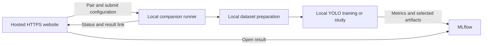

# Team Foxtrot: research into a free website for local YOLO training

Research date: **10 October 2026, Asia/Karachi**. Status: **research and candidate designs; no architecture or implementation has been approved or finalized**.

This report examines the existing repository and official documentation. Phase 5 (Jetson export/deployment) and Phase 6 (training CI/CD) are outside the requested scope. Local training replaces Colab as the main execution path under consideration. No training, service provisioning, account changes, dependency installation, or implementation changes were performed for this research.

## 1. Feasibility and the main constraint

**Yes: a website can configure dataset generation, select a YOLO model, launch training on a member's computer through an installed runner, organize automated tuning, and link to MLflow results.** Free software can provide every core component. Existing computers supply the compute; free hosting can serve the website, subject to provider limits.

The important distinction is between configuring a job in a browser and executing Python/PyTorch on the computer. An ordinary hosted webpage cannot directly start this repository's Python scripts, use arbitrary local files, or access the installed CUDA training environment. A local executable/service, an explicit downloaded-job handoff, or a locally hosted web application is required for this pipeline. Browser-native ML would be a different training implementation rather than a small extension of this project.

Consequently, these two interpretations have different feasibility:

| Interpretation | Assessment |
| --- | --- |
| Member installs a runner once; then uses website controls to train locally | Feasible; browser-to-runner transport needs investigation |
| Member downloads configuration and starts a local command | Feasible and relatively simple |
| Member opens a local website served by the installed Python app | Feasible; no public hosting required |
| Member opens a public website and the existing Python/CUDA pipeline runs with no local installation | Not a supported path for this repository |
| All services remain free regardless of team size, storage growth, privacy and uptime requirements | Cannot be guaranteed |

“Free” should mean **no required software subscription and no paid cloud training for the intended small-team workload**. Electricity, existing hardware, storage, setup time and maintenance remain real costs. Unlimited managed storage or guaranteed free GPU availability should not be assumed.

## 2. What the repository already provides

These are observations from local source inspection, not claims that the current pipeline was tested in this research.

| Area | Existing behavior | Implication for a website |
| --- | --- | --- |
| Roadmap | Synthetic UAV detection, DVC/DagsHub, MLflow, YOLOv8, optional Colab | Much of the underlying workflow is reusable |
| `params.yaml` | Dataset settings, two training settings, train/val ratios | Configuration is a starting point, not a complete application schema |
| Generator | `load_params()` then `main()`; fixed seed 42; shape labels | Needs a job-specific configuration and output location |
| Classes | Multiple `SHAPES` assignments; final effective list is Hexagon and Triangle | A model cannot learn the other shapes simply by adding a website dropdown |
| Split | Sorted filenames, seeded permutation, 80/20 train/val by default | No stratification, group split or labeled test split |
| Training | Fixed `YOLO("yolov8n.pt")`; forwards epochs and batch | Model selection and general parameter forwarding are missing |
| Tracking | Fixed DagsHub URI and experiment; credentials loaded from `.env` | Needs configurable destination and explicit run identity |
| Dataset logging | Retrieves `mlflow.last_active_run()` after training and adds generator/split parameters | Can skip logging if integration did not create a run; unsuitable as job ownership mechanism |
| Real images | `src/test.py` predicts on images and saves annotations | Visual inspection exists; quantitative real-world accuracy does not |
| Weight lookup | First `best.pt` found during a walk through `runs/` | May evaluate a different model from the job that just finished |
| DVC | Generate → split → train → test; `runs/` tracked as a training output | Useful provenance/cache, but not a web job scheduler |
| Dependencies | `requirements.txt` has unpinned versions | Different computers may accept different models/options and log differently |
| Website/runner | No web frontend or job API found in the inspected project sources | Requires new components, not only a form around `params.yaml` |

### Repository issues that affect feasibility

1. **The YAML and legacy CLI have different coverage.** `parse_terminal()` defines many options, but the script entry point calls `load_params()`, not `parse_terminal()`. Adding fields to the UI or passing flags will not automatically activate the legacy options. The README describes older paths/scripts and a three-way split that differ from the present DVC pipeline.
2. **Jobs currently share mutable paths.** Generation deletes/recreates output folders; splitting deletes `data/split`; training rewrites root `data.yaml`; runs use the same project/name. Concurrent users or trials in one checkout could overwrite each other. Isolation must precede concurrent execution.
3. **Seeding does not prove dataset determinism.** Background selection uses unsorted `os.listdir()`. Some random values are evaluated at import time, before `load_params()` seeds RNGs; actual impact needs testing. Cached resources, library versions and input ordering also matter. The generated dataset should be hashed rather than assumed identical.
4. **Image size needs semantic verification.** YAML loading changes letter resource sizes but does not call the old background-resizing branch. A `size` field should not be described as guaranteed output image dimensions without checking actual image creation. YOLO `imgsz` is a separate training resize setting.
5. **Labels need validation on non-square inputs.** Several normalization expressions divide x/width quantities by image height and y/height quantities by width. Square images can hide these issues; non-square background support needs inspection and labeled-image checks.
6. **Background availability needs preflight.** Selection repeatedly tries to find `.png`/`.jpg` files. A directory without eligible files can fail or loop; a clean validated file list is needed.
7. **Importing the generator only to obtain classes is fragile.** `src/train.py` imports `DataSetGeneration`, which imports additional modules and reads resources. A shared class manifest would avoid coupling training metadata to generator initialization.
8. **Three epochs are a smoke-test setting.** They do not establish model quality. Current test images also have no quantitative evaluation path through `src/test.py`.

These are future work candidates. None were changed.

## 3. Candidate architectures

### A. Hosted configuration website + downloaded job + local CLI

The member chooses a dataset recipe, model, parameters and optional search space. The website downloads a structured job file. An installed Foxtrot runner validates that file, generates or retrieves data, trains, uploads results and prints/opens a tracking link.

```text
Hosted website → job.json → installed local runner
                                    ↓
                         local dataset + PyTorch training
                                    ↓
                             MLflow tracking server
```

This can use a static website with no cloud application backend or job database. Credentials stay on the computer. The handoff survives browser closure, and dataset paths can be selected locally. It is also an effective fallback if browser-to-localhost communication is unavailable.

Tradeoffs: the website cannot reliably know that a downloaded job started or completed unless the runner sends status somewhere. The member must run a command or import the file through a local UI. A hosted page cannot automatically redirect at completion without a return/status channel; the CLI can present a link instead. This version fulfills local training and tracking but provides less seamless website control.

### B. Hosted website + companion runner on localhost

The member starts a local companion service. The website pairs with it, obtains capabilities, submits validated jobs and receives progress. The companion owns child training processes and communicates directly with MLflow.



This is a close match to the desired website experience without a central training scheduler. There is still a one-time installation and a running local service. Pairing, local-network browser permissions, CORS, reload recovery and OS packaging increase complexity. It should be prototyped against the team's actual browsers before becoming an architectural commitment.

### C. Local application serving both website and API

The installed app serves the interface and runner API from the same local origin. A member opens a localhost URL, configures a job and views progress in the browser. Results can still go to a shared DagsHub or team MLflow server.

This removes the hosted-page-to-local-service boundary and does not require cloud hosting or a cloud queue. It provides a website interface, but each member runs their own copy rather than accessing one central control URL. Versions and updates need distribution. A public team landing page could provide installation instructions and links without controlling training.

### D. Hosted website + small control backend + outbound-polling workers

The website stores job descriptions/status in a lightweight backend. Each paired local runner initiates outbound HTTPS requests to claim jobs assigned to that user/device. Training remains local; the backend coordinates metadata only.

Advantages: centralized history and status, no hosted-browser fetch to localhost, runners can remain available while tabs close. Costs: real authentication, per-user ownership, device enrollment, a database, leases/heartbeats, idempotency, quota monitoring and maintenance. This is an application control plane, **not the skipped Phase 6 cloud training CI/CD**, but it is still more scope than a configuration website.

A queued job cannot train on a switched-off computer. Jobs should target the submitting member's paired device by default. Distributing trials to other teammates' machines is a separate opt-in feature, not implied by local training.

### Comparative assessment

| Property | A: file handoff | B: localhost companion | C: local website | D: polling workers |
| --- | --- | --- | --- | --- |
| Public team URL | Yes | Yes | Landing page optional | Yes |
| Local installation | Required | Required | Required | Required |
| Start directly through website | No, explicit handoff | Yes, after pairing/permissions | Yes | Yes, runner online |
| Browser progress | Limited without added channel | Yes | Yes | Yes |
| Cloud job backend | None | None necessary | None | Required |
| Private configuration can stay local | Yes | Yes | Yes | Less so; backend stores job metadata |
| Browser-to-local networking risk | Low | Highest | Low | Low |
| Engineering complexity, relative | Lower | Medium | Lower/medium | Highest |

These are research alternatives, not a selected stack.

## 4. Local execution and job lifecycle

Regardless of the frontend, a future runner should accept structured data rather than executable shell text. Proposed responsibilities are an engineering inference from this repository's requirements:

1. Validate job format/version, allowed model, types, ranges, task and local paths.
2. Check Python/library versions, accelerator availability, free disk space, dataset accessibility and tracking access.
3. Save the submitted configuration as an immutable manifest with job ID and configuration hash.
4. Create a job workspace; resolve input data and class mapping.
5. Generate/preprocess/split as necessary; validate dataset and save its manifest/hash.
6. Create a tracking run or study parent and retain the exact IDs.
7. Launch a separate training process or sequential trial processes.
8. Persist epoch progress and logs independently of the browser connection.
9. Log final evaluation and artifacts; report upload status separately from training status.
10. Return an exact model path and tracking URL.

Possible states:

```text
created → validated → queued → preparing → training → evaluating → syncing → completed
                         ↘ failed / cancelled
```

Keep separate flags for `training_finished`, `tracking_synced` and runner connectivity. A completed training job with an upload failure should remain recoverable. Closing a tab should not kill training. If a tab is closed, automatic navigation is impossible; reopening the interface should recover status and offer the result link.

Cancellation should signal the owned process and allow a bounded graceful shutdown before termination. Mark the trial cancelled, preserve useful logs/checkpoints and stop launching further trials. Resume is distinct: continuing an interrupted checkpoint may constrain which settings can change, and restarting a study should skip completed trials rather than silently repeat them.

Local persistence could use SQLite for jobs plus files for manifests/events/artifacts. A single worker per GPU is a conservative candidate until memory use is measured. UI responsiveness requires a process/queue boundary; a multi-hour `model.train()` call should not run synchronously in an HTTP request handler.

## 5. Meaning of “all parameters”

There is no single universal list covering every YOLO family, task and library version. A practical coverage contract is: **all supported parameters for the selected, tested runtime/model/task, plus all supported Foxtrot dataset settings**. Unknown, unsupported and inapplicable parameters should be rejected or clearly disabled, rather than silently ignored.

Proposed schema metadata for each field:

```text
canonical name, display label, category, type, default, valid domain,
description/unit, task/family/version applicability, dependencies,
whether user-editable, whether tunable, search-space representation
```

A runtime-derived list of configuration keys can help detect omissions. Human-maintained metadata is still needed: a defaults file does not completely describe bounds, task dependencies, tuning suitability or UI behavior. A coverage report could compare the supported runtime keys against the website schema whenever the team updates its pinned environment.

Some settings need ownership rules. `data` should resolve to the validated dataset; `project`/`name` should resolve to the job's output folder; device selection must match local hardware. Exposing these settings does not require allowing a website to write anywhere on the member's filesystem. A structured advanced editor can cover uncommon fields, provided the runner applies the same validation as the forms.

### Dataset parameters found in this repository

| Group | Loaded from present YAML | Additional source/legacy options requiring integration |
| --- | --- | --- |
| Size/count | `n`, `size` | Separate letter crop size; actual generated dimensions need verification |
| Shape geometry | `shape_scale.s0/s1` | Shape list/class order, border bounds, controlled rotation/position policies |
| Noise/blur | `noise`, `blur.b0/b1` | Alternate blur bounds/probability |
| Appearance | `brightness_diff`, contrast alpha bounds, brightness beta bounds, saturation bounds, desaturate | Broader color/background policies if explicitly implemented |
| Letters | Add letters, probability | Letter-only/letter dataset modes, absolute rotation probability, crop size |
| Lighting | Enable gradient, probability, opacity upper bound | Blend mode and explicit lower/upper opacity |
| Split | Train/val ratios | Configurable seed, group/stratified split, optional held-out labeled test set |
| Reproducibility | Fixed seed in code | Separate generation/split/training/search seeds; input and resource hashes |
| Diagnostics | Mostly constants/legacy CLI | Preview samples, bounds, distribution plots; replace blocking GUI/debug features |

Not every wished-for parameter already exists in executable behavior. New controls for geometry, class balancing or background policy may require generator changes. Shape count, image count, class order and actual label format must agree across generation, split, training and logging.

Validation needs lower ≤ upper checks, probabilities within [0,1], positive counts/dimensions, compatible blur ranges, valid class IDs, nonempty splits and safe local paths. Warnings about compute/storage estimates belong next to the selected study budget, rather than allowing an accidental enormous grid.

### Generator randomness versus tuning randomness

A generator range such as shape scale 0.2–0.6 samples object sizes **inside one generated dataset**. A tuning range samples training or dataset-recipe choices **between trials**. These must be separate controls. For example, tuning a lower and upper shape-scale endpoint requires a constraint that lower ≤ upper; independently sampling both endpoints can produce invalid recipes.

## 6. Dataset design and fair evaluation

The current project generates detection bounding boxes. Other tasks require different supervision; a segmentation, pose or OBB checkpoint is not compatible merely because it belongs to a YOLO family. A detection dataset normally uses class ID and normalized center/width/height box coordinates. Dataset configuration identifies splits and class names. Source: [Ultralytics detection dataset format](https://docs.ultralytics.com/datasets/detect/).

Possible dataset modes for a future UI are: generate from Foxtrot backgrounds; use a local existing YOLO-format dataset; or pull a fixed DVC version. The browser can express an input reference, but the runner must resolve the real local directory. Uploading full image datasets to the website is unnecessary for local training and consumes cloud storage.

For training-only tuning, prepare one immutable dataset/split and reuse it across trials. For dataset-recipe tuning, regenerate only when that recipe changes and cache by recipe plus input hashes. Keep the evaluation set fixed. If each trial generates both training and validation data from its own recipe, a candidate can win by making its validation set easier instead of learning a better detector.

For this UAV project, synthetic validation measures performance on synthetic imagery. Meaningful real-flight performance requires labeled real images. The existing annotated prediction stage is useful for visual review but cannot produce mAP without ground-truth labels. A candidate study objective is mAP50–95 on a fixed validation set; recall of small targets or a multi-objective score may be more appropriate after team discussion. Standard YOLO validation exposes detection metrics such as precision, recall and mAP. Source: [Ultralytics validation](https://docs.ultralytics.com/modes/val/).

Related synthetic images derived from the same background or related frames from the same flight can leak across random image splits. Consider grouping by source background, scene or flight. Reserve a final test set that is not used to select hyperparameters. Compare promising configurations under repeated seeds before treating a small metric difference as meaningful.

Record generation, split and training seeds separately. Pin runtime versions and save input manifests. PyTorch explicitly does not guarantee identical results across releases/platforms or between CPU and GPU, even with the same seeds. Deterministic modes can reduce variability at a speed cost. Source: [PyTorch reproducibility](https://docs.pytorch.org/docs/stable/notes/randomness.html).

## 7. MLflow: define what “all results” means

MLflow stores experiment/run metadata and artifacts; it also provides comparison and result browsing. A run can carry parameters, metrics, tags and files, while datasets can be associated through dataset logging APIs. This does not automatically upload every dataset or all outputs of custom scripts. Source: [MLflow tracking overview](https://www.mlflow.org/docs/latest/tracking/).

Proposed Foxtrot logging contract:

| Category | Suggested content |
| --- | --- |
| Identity | Job/study/trial ID, author, timestamps, status and reason for failure/cancellation |
| Provenance | Git revision and dirty state, runtime versions, model family/task/checkpoint hash, device summary |
| Configuration | Submitted job file; complete resolved defaults and overrides; generator/split settings |
| Dataset | Manifest/hash, class mapping, actual counts, input/DVC revision, split policy/seeds |
| Per-epoch data | Train/val losses, objective/validation metrics, learning rate, elapsed time |
| Final data | Best epoch, final objective, evaluation summary and resource/time usage |
| Artifacts | Selected weights, results CSV, plots/confusion matrix, dataset previews, config and sanitized logs |
| Study summary | Search definition, trial outcomes, best trial/model links, resource budget and sampler seed |

This is a proposed application contract, not a claim that existing autologging covers it. Keep secrets and unnecessary personal machine paths out of uploaded manifests/logs.

The current upstream Ultralytics MLflow callback requires MLflow settings to be enabled. It logs trainer arguments, epoch losses/learning rates, validation metrics and selected artifacts. It has run-lifecycle controls, and logging errors can disable tracking while training continues. Therefore “training succeeded” is not proof that tracking succeeded. Pin and inspect the actual installed integration; avoid relying on comments in `src/train.py` that promise everything is logged. Source: [Ultralytics MLflow callback implementation](https://github.com/ultralytics/ultralytics/blob/main/ultralytics/utils/callbacks/mlflow.py).

Two integration candidates are retaining that callback plus explicit Foxtrot metadata, or owning the full run/logging lifecycle through a custom adapter. Do not enable duplicate overlapping integrations unintentionally. For tuning, use one study parent and one child run per trial. Failed/pruned trials should remain visible, with their latest metrics and reasons.

MLflow supports nested runs and explicit run IDs; capture those IDs at creation. Parameters should remain fixed within a trial: log sampled values once, and use metrics/artifacts for progress. Source: [MLflow Python run API](https://mlflow.org/docs/latest/api_reference/python_api/mlflow.html).

Optional system metrics require extra dependencies and enabling collection; CPU, memory and GPU telemetry are not guaranteed by importing MLflow. Source: [MLflow system metrics](https://mlflow.org/docs/latest/ml/tracking/system-metrics/).

### Redirects and tracking outages

Store a **tracking API URI** separately from a **human-facing UI base URL**. A repository's `.mlflow` API endpoint is not automatically the correct result page. Resolve the UI link from the actual experiment/run IDs using the selected service's route. Test deep links against that service, including login and private-repository access. A known run ID is more reliable than guessing which run is latest.

For a single job, return its run link. For tuning, return the study/experiment view plus the best trial link. Create a persistent “View in MLflow” action; automatic navigation after completion can be optional. Browser popup restrictions and a closed tab make a mandatory automatic redirect brittle.

Network failure needs an explicit policy. Candidate options: fail before spending compute if tracking is mandatory; or train with a durable local event/artifact spool and upload later. **MLflow remote tracking is not automatically an offline synchronization system.** A retry/replay mechanism needs to preserve metric steps, run association and upload checkpoints. Training and tracking status should be visible independently.

## 8. DVC's role in the expanded workflow

DVC can remain the dataset/versioning/cache layer; MLflow can remain the experiment browsing layer. A web job must retain the exact dataset hash/revision and model path, rather than infer identity from mutable shared folders.

DVC reproduction checks stage dependencies and may restore cached outputs instead of executing a command. A repeated “Train” action therefore needs defined semantics: reuse an existing result, deliberately repeat an experiment, or execute a new trial. Source: [DVC repro](https://doc.dvc.org/command-reference/repro).

DVC also offers isolated queued experiments, parameter overrides and grid-style sweeps. This could reuse more of the existing pipeline. Its queue is an alternative local execution mechanism rather than an adaptive optimizer by itself. Isolated execution excludes certain ignored/untracked files, so credentials and input datasets need deliberate handling. Source: [DVC experiment execution](https://doc.dvc.org/user-guide/experiment-management/running-experiments).

Two integration approaches remain open: retain DVC execution within isolated experiment workspaces, or refactor reusable generation/split/train functions for a runner while using DVC to identify/retrieve inputs. Avoid modifying global `params.yaml` for every web submission or every concurrently running trial.

Uploading every generated trial dataset and checkpoint to both DVC and MLflow would duplicate large data. Retention policies could preserve base backgrounds, dataset manifests, metrics and winning artifacts centrally while retaining intermediate datasets/checkpoints locally. Reproducibility requirements determine whether a manifest/recipe is sufficient or the exact dataset must also be retained.

